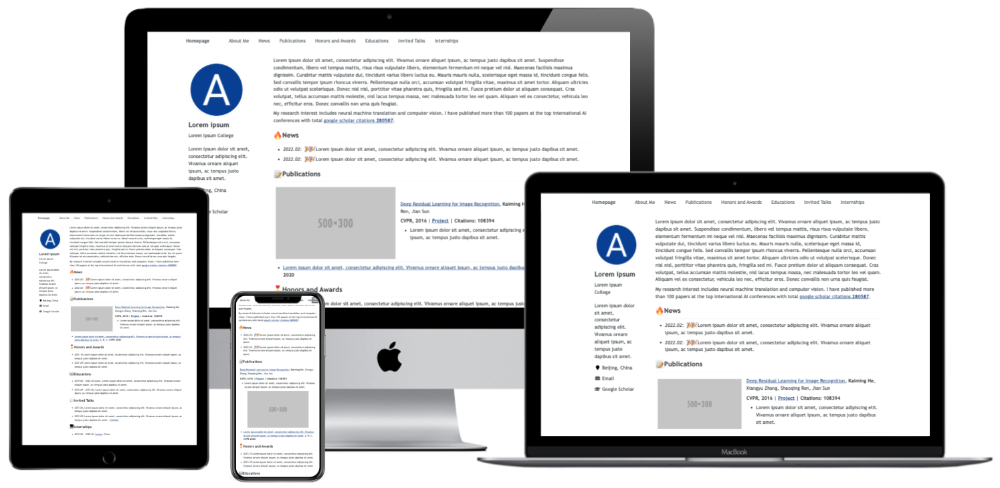

<h1 align="center">
AcadHomepage
</h1>

  | [English README](./docs/README-en.md) 

一个现代、响应式的个人学术主页

     
    
     

一些例子：
- [样例页面](https://rayeren.github.io/acad-homepage.github.io/)
- [作者的个人主页](https://rayeren.github.io/)

## 主要特点
- **引用数与 Google Scholar 保持一致**: 每天直连 Google Scholar 个人主页解析最新数值，写入仓库内的 `assets/data/citations.json`，页面从同源读取，不经过 CDN 缓存或跨站请求。
- **可靠的降级**: 直连被拦时依次尝试 `scholarly`、OpenAlex、Semantic Scholar，全部失败则保留上次快照并标注「缓存」与数据日期，页面不会空白或显示错误数字。
- **每篇论文自动显示引用数**: 按论文标题自动匹配，不需要手工填写 Google Scholar 论文 ID；侧栏同时显示总引用数、h-index、i10-index、数据来源与更新时间。
- **支持谷歌Analytics**: 你可以通过简单的配置来实现使用谷歌Analytics跟踪网页的流量。
- **响应式的**: 此主页会针对不同的屏幕尺寸自动调整布局。
- **美观而简约**: 此主页美观而简约，适合个人学术主页的搭建。
- **搜索引擎优化**: 搜索引擎优化 (SEO) 帮助搜索引擎轻松找到您在主页上发布的信息，然后将其与类似网站进行排名，并获得排名优势。

## 快速开始

1. Fork本仓库到`USERNAME/USERNAME.github.io`，其中`USERNAME`是你的github用户名。
1. 确认 `_config.yml` 里的 `author.googlescholar` 是你的 Google Scholar 主页链接，爬虫会从中读取学术 ID（也可用 Secret `GOOGLE_SCHOLAR_ID` 覆盖）。
1. 配置工作流（可选但建议）：
    1. `OPENALEX_API_KEY`：https://openalex.org/settings/api 免费申请。
    1. `S2_API_KEY`：https://www.semanticscholar.org/product/api#api-key-form 免费申请。
    1. Google Scholar 没有官方 API，CI 出口 IP 偶尔会被拦截；两个开放学术 API 的免费额度按 IP 共享，不带 key 时容易被限流。配置 key 后兜底才真正可靠。
    1. 在 `Actions` 页面启用 workflow。它每天 08:00 UTC 运行（也可手动 `workflow_dispatch`），把数据写回 `assets/data/citations.json`；数值无变化时不产生提交。提交会触发 Pages 重新构建，页面随之更新。
    1. 也可以本地执行 `python3 google_scholar_crawler/main.py` 立即刷新数据，然后提交该文件。
1. 页面会自动按论文标题匹配引用数并插入徽章，**不需要**给每篇论文手写 ``；新增论文只要标题能在引用数据里找到就会自动带上数字。
1. 使用 [favicon-generator](https://redketchup.io/favicon-generator)生成favicon（网页icon文件），并下载所有文件到`REPO/images`。
1. 修改主页配置文件[_config.yml](../_config.yml):
    1. `title`: 主页标题
    1. `description`: 主页的描述
    1. `repository`: USER_NAME/REPO_NAME  
    1. `google_analytics_id` (可选的): 谷歌Analytics ID
    1. SEO相关的键值 (可选的): 从搜索引擎的控制台里获得对应的ID (例如：Google, Bing and Baidu)，然后粘贴到这里。
    1. `author`: 主页作者信息，包括其他网页、Email、所在城市、大学等。
    1. 更多的配置信息在注释中有详细描述。
1. 将你的主页内容添加到 [_pages/about.md](../_pages/about.md).
1. 你的主页将会被部署到`https://USERNAME.github.io`.

## 本地调试

1. 使用`git clone`将本项目克隆到本地。
1. 安装Jekyll的构建环境，包括`Ruby`、`RubyGems`、`GCC`和`Make`。可参考[该教程](https://jekyllrb.com/docs/installation/#requirements)。
1. 运行 `bash run_server.sh` 来启动Jekyll实时重载服务器。
1. 在浏览器里打开 [http://127.0.0.1:4000](http://127.0.0.1:4000)。如果你修改了网页的源码，服务器会自动重新编译并刷新页面。
1. 当你修改完毕你的页面以后, 使用`git`命令，`commit`你的改动并`push`到你的github仓库中。

# Acknowledges

- AcadHomepage incorporates Font Awesome, which is distributed under the terms of the SIL OFL 1.1 and MIT License.
- AcadHomepage is influenced by the github repo [mmistakes/minimal-mistakes](https://github.com/mmistakes/minimal-mistakes), which is distributed under the MIT License.
- AcadHomepage is influenced by the github repo [academicpages/academicpages.github.io](https://github.com/academicpages/academicpages.github.io), which is distributed under the MIT License.
