

I am a 4th-year Ph.D. student from the School of [Computer Science](https://cs.fudan.edu.cn/), [Fudan University](https://www.fudan.edu.cn/).
My research interests include   
- *natural language processing*, 
- *efficient machine learning and downstream adaptation* and 
- *scaling of reinforcement learning*.

I am fortunate to be advised by [Prof. Yu Wang](https://yuwangsjtu.github.io/) and [Prof. Ya Zhang](https://mediabrain.sjtu.edu.cn/yazhang/). My [CV](/pdf/resume.pdf) is available here.

# 🎓 Educations
- *2023.06 - Current*,  Fudan University, School of Computer Science, Shanghai, Ph.D.
- *2019.09 - 2023.06*, <a href="https://www.sjtu.edu.cn/">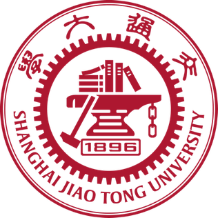</a> Shanghai Jiao Tong University, School of Electronic Information and Electrical Engineering, Shanghai, Bachelor Degree
 
# 📝 Publications

### Highlight
---

ICLR 2026 Oral
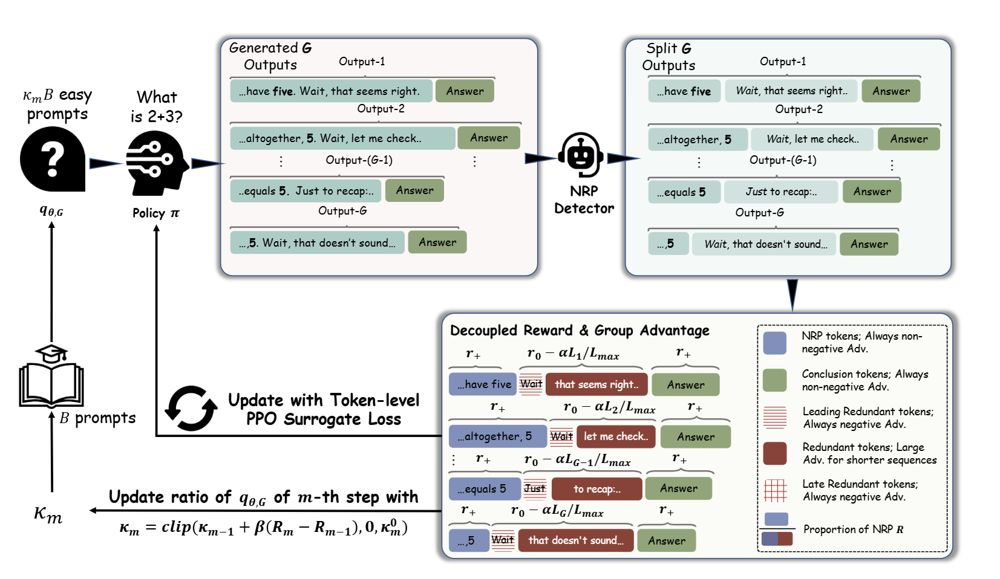

-	`Jiang, S.`, Liao, Y., Zhang, Y., Wang, Y., & Wang, Y. (2026). Overthinking Reduction with Decoupled Rewards and Curriculum Data Scheduling. In The Fourteenth International Conference on Learning Representations. 
[[Link]](https://openreview.net/pdf?id=kdeiRledV6) 

ICLR 2025 Spotlight
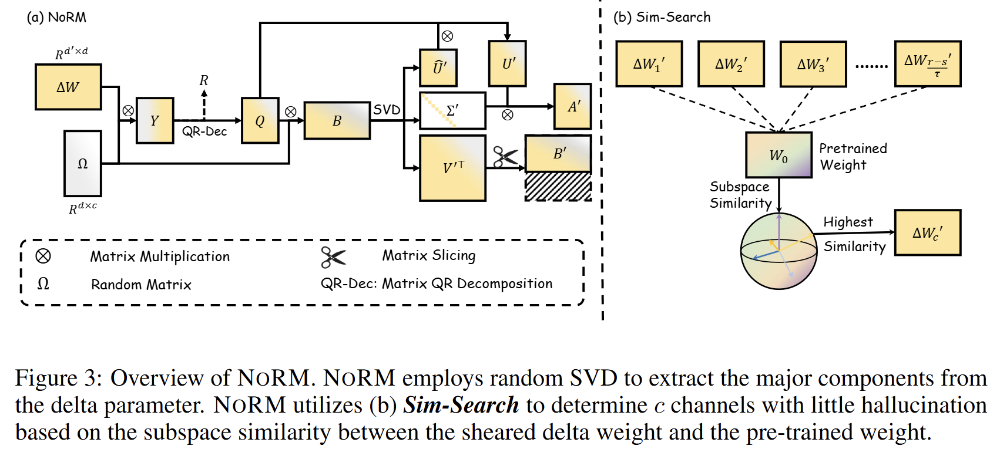

-	`Jiang, S.`, Liao, Y., Zhang, Y., Wang, Y., & Wang, Y. (2025). Fine-tuning with Reserved Majority for Noise Reduction. In The Thirteenth International Conference on Learning Representations. 
[[Link]](https://openreview.net/pdf?id=ZV7CLf0RHK) 

ACL 2026 Main
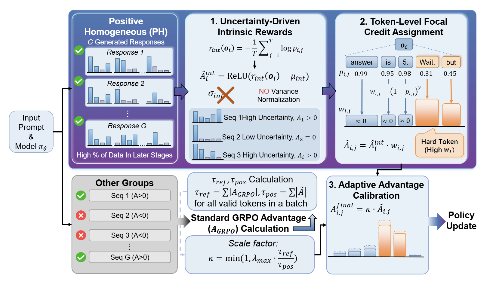

-	`Jiang S`, Wang Y, Zhang Y, et al. Miner: Mining Intrinsic Mastery for Data-Efficient RL in Large Reasoning Models[J]. ACL 2026.  
[[Link]](https://arxiv.org/pdf/2601.04731) 

AAAI 2026 Poster
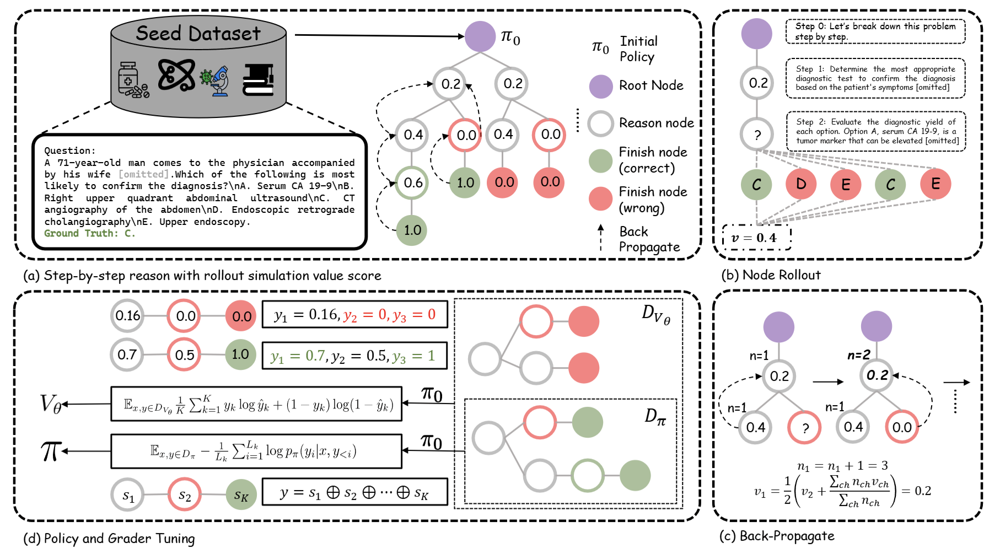

-	`Jiang S`, Liao Y, Chen Z, et al. MedS3: Towards Medical Slow Thinking with Self-Evolved Soft Dual-sided Process Supervision[J]. AAAI 2026.  
[[Link]](https://arxiv.org/pdf/2501.12051) 

NeurIPS 2024 Poster
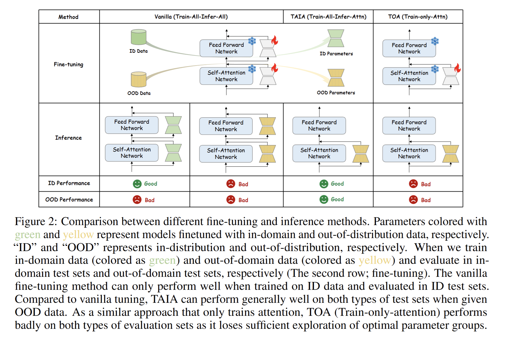

-	`Jiang, S.*`, Liao, Y.*, Zhang, Y., Wang, Y., & Wang, Y. (2024). TAIA: Large Language Models are Out-of-Distribution Data Learners. In Advances in Neural Information Processing Systems (pp. 105200–105235). Curran Associates, Inc.. 
[[Link]](https://arxiv.org/pdf/2405.20192) 

ICML 2023
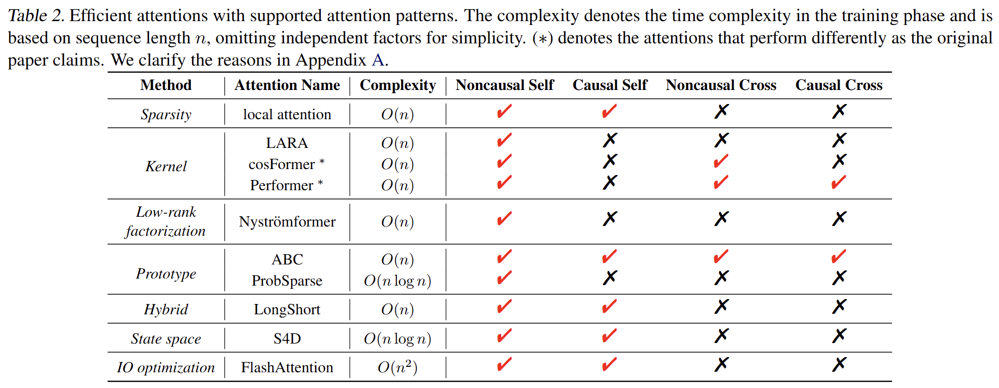

-	Zhang, J.*, `Jiang S.*`, Feng J., et al. Cab: comprehensive attention benchmarking on long sequence modeling[C]//International Conference on Machine Learning. PMLR, 2023: 41194-41218.   
[[Link]](https://proceedings.mlr.press/v202/zhang23r/zhang23r.pdf) 

Arxiv Preprint
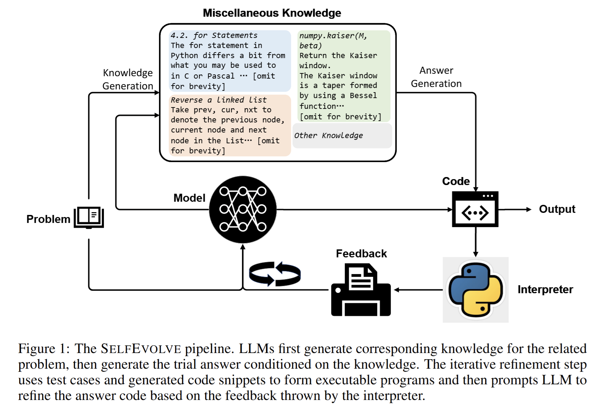

-	`Jiang S.`, Wang Y., & Wang Y. Selfevolve: A code evolution framework via large language models[J]. arXiv preprint arXiv:2306.02907, 2023.    
[[Link]](https://arxiv.org/pdf/2306.02907) 

ECML-PKDD 2023
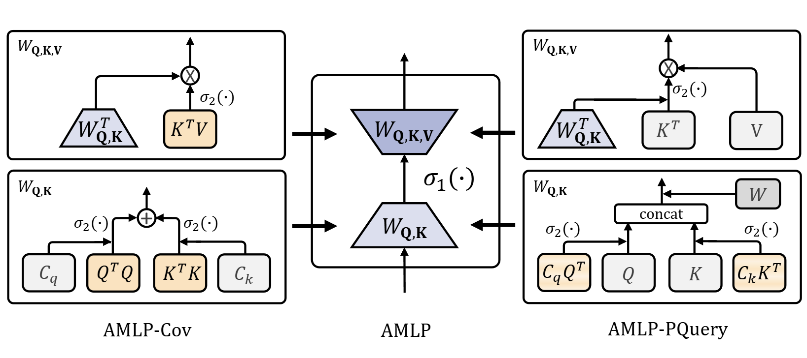

-	`Jiang S.`, Zhang J., Feng J., et al. Attentive Multi-Layer Perceptron for Non-autoregressive Generation[C]//Joint European Conference on Machine Learning and Knowledge Discovery in Databases. Cham: Springer Nature Switzerland, 2023: 612-629.   
[[Link]](https://arxiv.org/pdf/2310.09512) 

### Others
---

ACL 2025 Oral
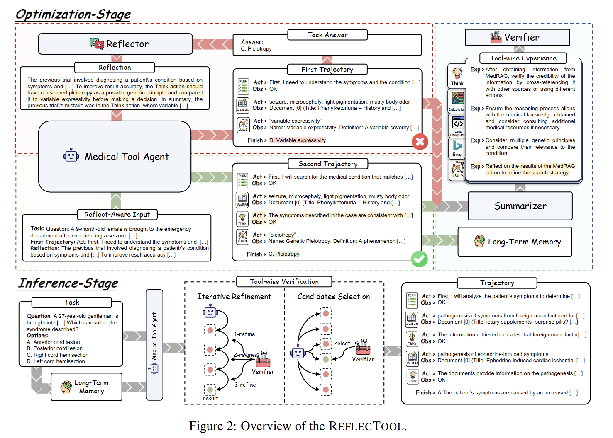

- Liao Y., `Jiang S.`, Wang Y, et al. ReflecTool: Towards Reflection-Aware Tool-Augmented Clinical Agents. In Proceedings of the 63rd Annual Meeting of the Association for Computational Linguistics (Volume 1: Long Papers), pages 13507–13531, Vienna, Austria. Association for Computational Linguistics. 
[[Link]](https://aclanthology.org/2025.acl-long.663.pdf) 

EMNLP 2025 Main
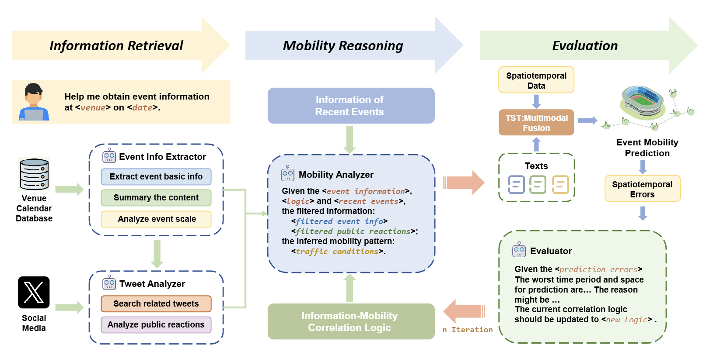

- Chen, R., `Jiang, S`., & Huang, W. (2025). SeMob: Semantic Synthesis for Dynamic Urban Mobility Prediction. In Proceedings of the 2025 Conference on Empirical Methods in Natural Language Processing, pages 15346–15366, Suzhou, China. Association for Computational Linguistics. 
[[Link]](https://aclanthology.org/2025.emnlp-main.775.pdf) 

EMNLP 2024 Findings
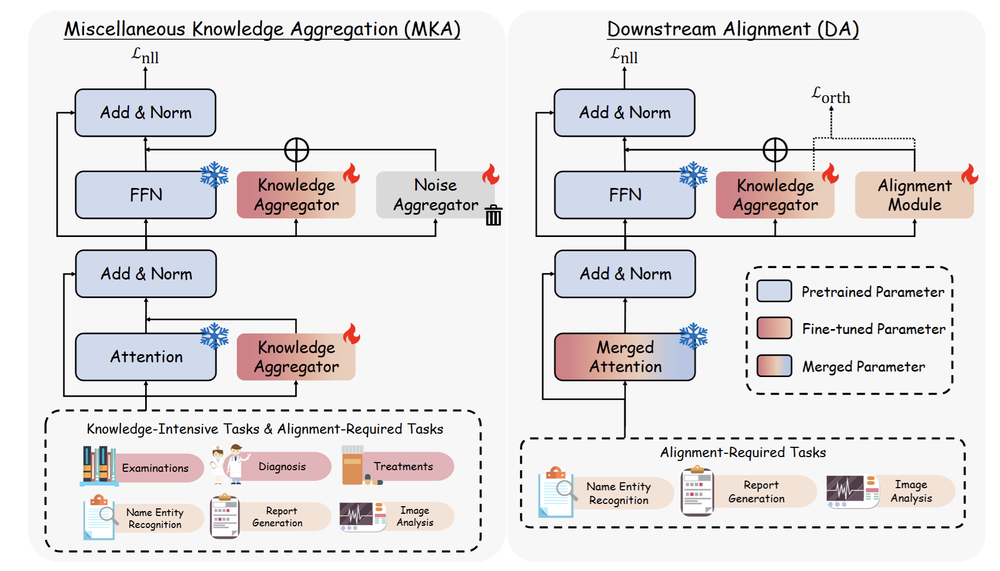

-	Liao Y*, `Jiang S*`, Chen Z, et al. MedCare: Advancing medical LLMs through decoupling clinical alignment and knowledge aggregation[C]//Findings of the Association for Computational Linguistics: EMNLP 2024. 2024: 2538-2554.   
[[Link]](https://arxiv.org/pdf/2406.17484) 

EMNLP 2024 Findings
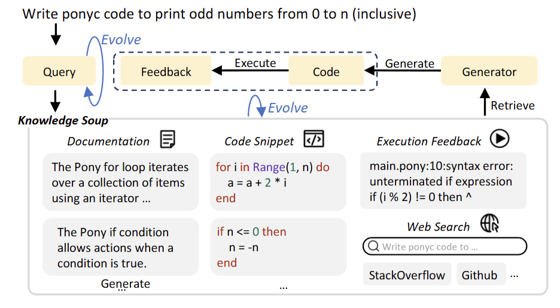

-	Su H, `Jiang S`, Lai Y, et al. EvoR: Evolving Retrieval for Code Generation[C]//Findings of the Association for Computational Linguistics: EMNLP 2024. 2024: 2538-2554.   
[[Link]](https://aclanthology.org/2024.findings-emnlp.143.pdf) 

# 💻 Internships
- *2022.01 - 2023.04*, Shanghai Artificial Intelligence Laboratory, Intern Researcher
- *2026.07 - present*, Tencent Workbuddy Team, Intern Researcher
